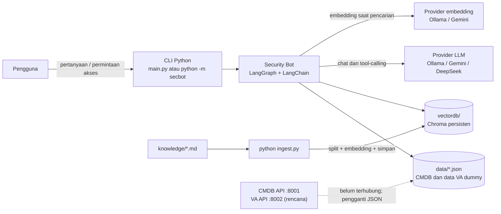
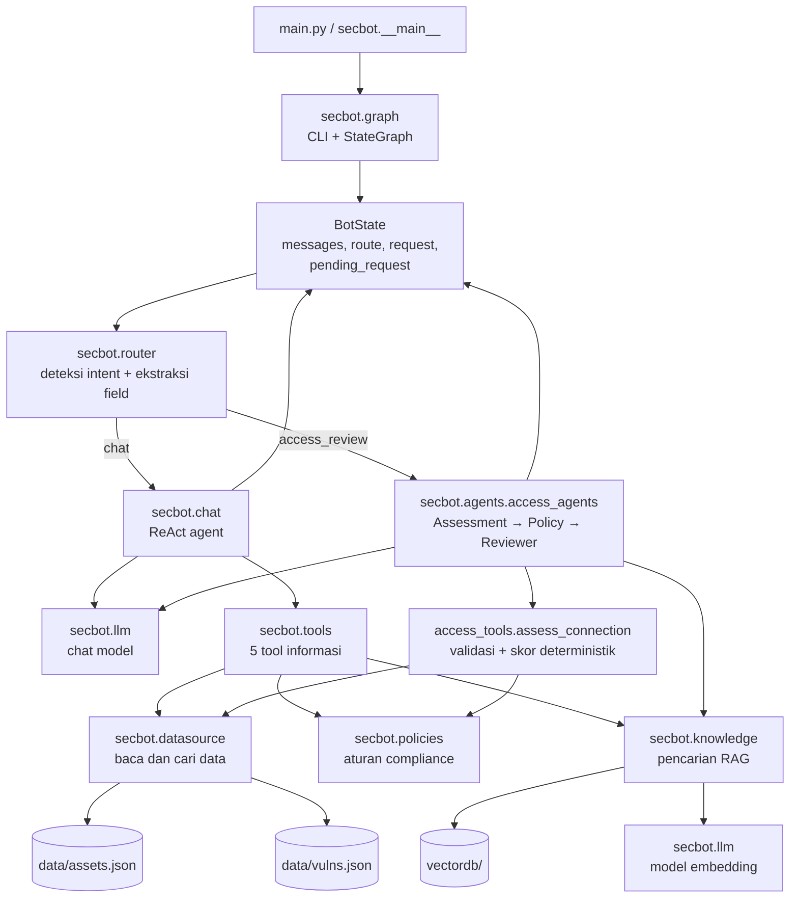
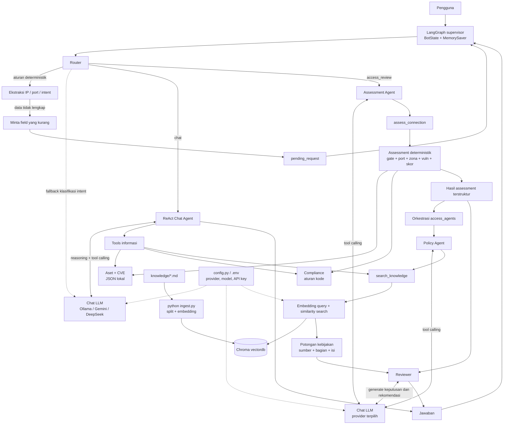
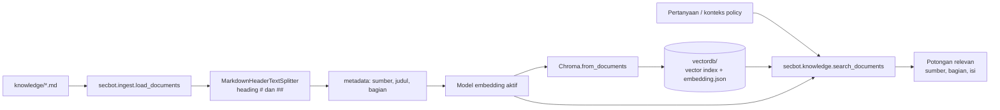

# Arsitektur Aplikasi Security Bot

Dokumen ini menjelaskan arsitektur yang benar-benar diterapkan di repository saat
ini. Aplikasi adalah CLI Python dengan dua kemampuan: tanya-jawab keamanan dan
review permintaan pembukaan koneksi jaringan.

## 1. Konteks sistem

Pengguna berinteraksi melalui terminal, baik secara interaktif maupun dengan satu
pertanyaan sebagai argumen. Tidak ada web server atau API publik pada implementasi
saat ini. Provider model dan lokasi data dikonfigurasi melalui environment variable
atau `.env`.

## 2. Komponen aplikasi

### Tanggung jawab modul

| Komponen | Tanggung jawab |
|---|---|
| `main.py`, `secbot.__main__` | Entry point CLI; keduanya meneruskan eksekusi ke `secbot.graph.main()`. |
| `secbot.graph` | Membangun grafik LangGraph, mengelola state dan checkpoint percakapan, memilih cabang, serta menjalankan CLI. |
| `secbot.router` | Mengekstrak IP/port/protocol, mengenali kata kunci akses, mempertahankan klarifikasi yang masih pending, dan menentukan rute. |
| `secbot.chat` | Membuat ReAct agent untuk pertanyaan informasi dengan system prompt dan tool chat. |
| `secbot.tools` | Menyediakan fungsi domain deterministik dan wrapper tool yang dapat dipanggil LLM. |
| `secbot.agents.access_tools` | Menilai permintaan jaringan: validasi, kontrol keamanan, port, zona, vulnerability, skor dan keputusan awal. |
| `secbot.agents.access_agents` | Mengorkestrasi agen Assessment, Policy, dan Reviewer; meneruskan data assessment mentah ke Reviewer. |
| `secbot.datasource` | Batas akses data aset dan vulnerability. Implementasi sekarang membaca JSON lokal. |
| `secbot.policies` | Aturan operasional yang dihitung kode: compliance, kontrol akses, port dan severity. |
| `secbot.knowledge` | Membuka Chroma, membuat embedding saat pencarian, mencari potongan dokumen dan memeriksa kesesuaian model embedding. |
| `secbot.ingest` | Membaca dokumen Markdown, memecahnya berdasarkan heading, meng-embed, dan membangun ulang Chroma. |
| `secbot.config`, `secbot.llm` | Memuat konfigurasi serta membangun model chat dan embedding sesuai provider. |

### Topologi AI

File diagram editable untuk diagrams.net: [topology-ai.drawio](./topology-ai.drawio).

**Makna koneksi:** garis penuh menggambarkan aliran data atau pemanggilan komponen;
garis putus-putus menunjukkan pemakaian model/configuration. Router tidak selalu
memanggil LLM: ekstraksi dan aturan akses dijalankan terlebih dahulu secara
deterministik. Pada jalur review akses, perhitungan skor dilakukan oleh kode; model
dipakai untuk menjalankan agen/tool, mengambil aturan, dan menghasilkan narasi.
Chat dan router memakai model yang dibuat saat grafik dibangun, sedangkan review
akses membuat instance model sesuai konfigurasi saat review dijalankan.

## 3. Alur runtime

### 3.1 Alur tanya-jawab

1. CLI mengirim pesan pengguna ke grafik dengan `thread_id` sesi.
2. Router mencoba aturan deterministik terlebih dahulu. Pertanyaan aset, compliance,
   CVE, SLA, atau kebijakan yang bukan permintaan akses masuk ke cabang chat.
3. ReAct agent memilih satu atau beberapa tool berdasarkan maksud pertanyaan:
   `search_asset`, `get_asset_by_ip`, `get_vulns_by_ip`, `check_compliance`, atau
   `search_knowledge`.
4. Tool memperoleh data dari JSON, aturan kode, atau hasil retrieval Chroma.
5. LLM menyusun jawaban berdasarkan hasil tool; system prompt meminta sumber data
   disebutkan dan melarang klaim yang belum didukung hasil tool.
6. Jawaban dan pesan tool berada dalam state percakapan yang sama.

### 3.2 Alur review akses jaringan

1. Router mengekstrak source IP, destination IP, port, dan protocol. Dua IP valid
   beserta port atau kata kunci kuat pembukaan/review akses mengarahkan permintaan
   ke `access_review`. LLM hanya menjadi klasifikasi cadangan.
2. Jika source, destination, atau port belum tersedia, bot meminta klarifikasi dan
   menyimpan nilai yang sudah terkumpul sebagai `pending_request`. Balasan berikutnya
   dapat melengkapi field tersebut; pesan lain tidak otomatis mewarisi permintaan lama.
3. **Assessment Agent** memanggil `assess_connection`. Kode memvalidasi input dan
   menghitung status registrasi CMDB, gate EDR/PAM/VA, risiko port, zona/environment,
   dampak vulnerability, skor risiko, hard block, dan `preliminary_decision`.
4. **Policy Agent** mencari aturan terkait pada knowledge base, termasuk kebijakan
   akses, pedoman port, serta aturan zona dan vulnerability.
5. **Reviewer Agent** merangkai assessment dan kutipan aturan menjadi keputusan serta
   rekomendasi. Keputusan yang ditulis tidak boleh lebih longgar dari
   `preliminary_decision`; nilai assessment diambil dari output tool, bukan ringkasan
   Assessment Agent.

Penilaian dan keputusan awal adalah deterministik di kode. LLM bertugas memilih tool,
mengambil/merangkum aturan berbasis dokumen, dan menjelaskan hasil kepada pengguna.

## 4. Alur ingest dan retrieval knowledge

`python ingest.py` membangun ulang index dari dokumen Markdown. Saat runtime,
`search_knowledge` mencari tiga potongan paling relevan secara default. Marker
`vectordb/embedding.json` mencatat provider dan model yang membangun index; aplikasi
menolak retrieval dengan pesan yang dapat ditindak bila marker tidak cocok dengan
konfigurasi aktif. Index perlu dibangun ulang saat dokumen knowledge atau model
embedding berubah.

## 5. Data, state, dan konfigurasi

| Area | Implementasi saat ini | Ketahanan / batas |
|---|---|---|
| Data aset | `data/assets.json`, dibaca melalui `secbot.datasource` | Data contoh lokal; bukan koneksi CMDB live. |
| Data vulnerability | `data/vulns.json`, dibaca melalui `secbot.datasource` | Data hasil scan dummy; bukan koneksi VA live. |
| Dokumen kebijakan | File Markdown pada `knowledge/` | Source of truth untuk retrieval; sebagian aturan yang harus dihitung juga direpresentasikan di `secbot.policies`. |
| Vector index | Chroma pada `vectordb/` | Persisten di disk lokal, dibuat oleh perintah ingest. |
| Riwayat percakapan | LangGraph `MemorySaver` dan `thread_id` | Hanya in-memory selama proses berjalan; tidak dipersistenkan lintas restart. CLI memakai `sesi-1`. |
| Konfigurasi | `.env` opsional dan environment variable | Provider chat: Ollama, Gemini, atau DeepSeek. Provider embedding: Ollama atau Gemini. |

DeepSeek hanya digunakan untuk chat; embedding tetap memakai Gemini atau Ollama.
Secara default provider embedding mengikuti chat jika provider tersebut mendukung
embedding, dan untuk DeepSeek memilih Gemini bila API key-nya tersedia atau Ollama
sebagai fallback konfigurasi.

## 6. Struktur deployment dan batas saat ini

- **Cara menjalankan aplikasi:** proses Python lokal melalui `python main.py`,
  `python -m secbot`, atau mode satu pertanyaan.
- **Cara memperbarui knowledge:** proses CLI terpisah melalui `python ingest.py`.
- **Dependensi runtime:** LangChain/LangGraph, Chroma, splitter Markdown, dotenv,
  dan paket provider yang dipakai.
- **Integrasi eksternal:** provider LLM/embedding terpilih; Ollama dapat berjalan
  lokal, sedangkan Gemini/DeepSeek memerlukan API provider.
- **Belum termasuk:** UI web, endpoint layanan, autentikasi/otorisasi pengguna,
  database transaksional, audit store persisten, dan koneksi langsung CMDB/VA.

Untuk mengganti data dummy dengan layanan asli, batas integrasi yang dituju adalah
`secbot.datasource.load_assets()` dan `load_vulns()`. Perubahan pada integrasi itu
perlu mempertahankan bentuk data yang dipakai tool dan pipeline assessment.
