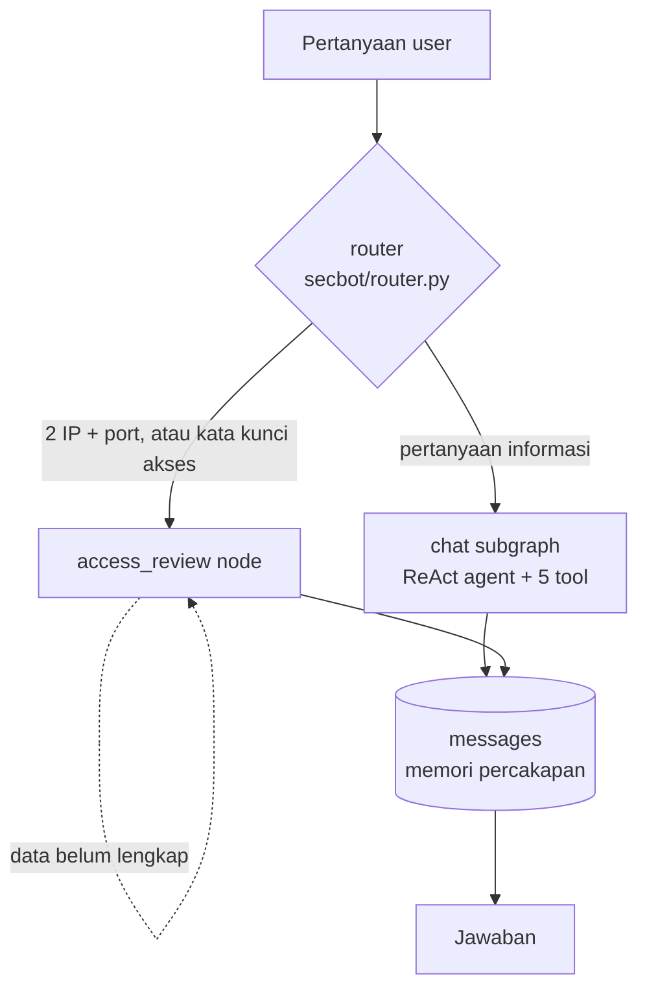

# Security Bot (LangChain + LangGraph + multi-provider LLM + data dummy)

Asisten keamanan untuk tim cybersecurity. **Satu pintu masuk, satu grafik, dua kemampuan:**

1. **Tanya-jawab** - aset, compliance, CVE, SLA, dan kebijakan.
2. **Review pembukaan akses** - pipeline 3 agen: Assessment -> Policy -> Reviewer.

Anda cukup menulis pertanyaan. Router di dalam grafik yang menentukan apakah
pertanyaan dijawab sebagai tanya-jawab biasa atau dijalankan sebagai review akses
formal. Tidak ada lagi perintah terpisah.

Prinsip utama: **angka dihitung kode, LLM hanya menarasikan.** Skor risiko, status
compliance, dan keputusan awal dihitung fungsi deterministik, bukan ditebak model.

Model bisa dari **Ollama** (lokal, gratis), **Google Gemini**, atau **DeepSeek** --
ganti satu baris konfigurasi, tanpa mengubah kode.

## Pilih provider model

| Provider | Model terringan (default) | Embedding | API key | Catatan |
|---|---|---|---|---|
| `ollama` | `qwen3:latest` | `bge-m3:latest` | tidak perlu | Jalan lokal & offline, tanpa biaya |
| `gemini` | `gemini-3.5-flash-lite` | `gemini-embedding-001` | `SECBOT_GEMINI_API_KEY` | Ada **free tier**; flash-lite = model tercepat & termurah di keluarga 3.x |
| `deepseek` | `deepseek-flash` | - (pakai Gemini/Ollama) | `SECBOT_DEEPSEEK_API_KEY` | OpenAI-compatible; **tidak punya API embedding** |

Embedding selalu butuh Gemini atau Ollama karena dipakai untuk vector DB knowledge base.
Bila provider chat = `deepseek`, embedding otomatis memakai Gemini (kalau API key Gemini
ada) atau Ollama. Karena itu **berpindah antara `gemini` dan `deepseek` tidak perlu
membangun ulang vector DB**; hanya pindah ke/dari `ollama` yang perlu
`python ingest.py` ulang (lihat catatan di bagian Jalankan).

### Cara mengisi API key

```bash
cp .env.example .env      # sekali saja
```

Lalu edit `.env`:

```ini
SECBOT_PROVIDER=gemini
SECBOT_GEMINI_API_KEY=AIza...      # https://aistudio.google.com/apikey
```

Selesai -- `.env` otomatis dibaca, dan `.env` sudah masuk `.gitignore` sehingga key
tidak ikut ter-commit. Bisa juga lewat environment variable tanpa file:

```bash
SECBOT_PROVIDER=deepseek SECBOT_DEEPSEEK_API_KEY=sk-... python main.py
```

Override model tanpa mengedit kode: `SECBOT_GEMINI_MODEL=gemini-2.5-flash`, `SECBOT_DEEPSEEK_MODEL=deepseek-v4-pro`, `SECBOT_LLM_MODEL=qwen2.5:14b`, dst.

## Arsitektur

Pola **supervisor router**: satu grafik state, router memilih cabang, kedua cabang
menulis ke riwayat pesan yang sama sehingga memori percakapan tetap nyambung.



Urutan keputusan router (deterministik dulu, LLM belakangan):

| Kondisi | Rute | Alasan |
|---|---|---|
| Ada 2 IP valid + nomor port | `access_review` | Paling pasti: itu memang permintaan koneksi |
| Ada kata kunci ("buka akses", "review koneksi", ...) | `access_review` | Kalau data belum lengkap, node review yang meminta kelengkapannya |
| Selain itu | `chat` / `access_review` | Ditentukan LLM sebagai cadangan terakhir |

Hanya permintaan yang benar-benar menyebut dua IP + port yang otomatis dianggap
review akses. Pertanyaan seperti "IP 10.10.5.21 ada di mana?" tetap masuk rute chat.

### Tahapan rute `access_review`

| Tahap | Agen | Tugas |
|---|---|---|
| 1 | Assessment Agent | Memanggil `assess_connection` untuk menghitung gate EDR/PAM/VA, level port, zona, severity vuln, skor risiko |
| 2 | Policy Agent | Mengambil aturan relevan dari knowledge base (`search_knowledge`) |
| 3 | Reviewer Agent | Menyusun keputusan + rekomendasi; tidak boleh lebih longgar dari `preliminary_decision` |

## Persiapan

```bash
python3 -m venv .venv && source .venv/bin/activate   # Windows: .venv\Scripts\activate
pip install -r requirements.txt

cp .env.example .env       # lalu isi API key provider pilihan Anda
```

Bila memakai Ollama (default), siapkan modelnya sekali:

```bash
ollama serve               # atau jalankan aplikasi desktop Ollama
ollama pull qwen3:latest   # LLM (harus support tool calling)
ollama pull bge-m3         # model embedding
```

Model yang pasti mendukung tool calling: `qwen2.5`, `qwen3`, `llama3.1`, `llama3.2`, `mistral-nemo`.

## Jalankan

```bash
python ingest.py              # sekali saja (lihat catatan di bawah)

python main.py                # aplikasi utama: satu pintu, tanya apa saja
python main.py "Buka akses dari 172.16.1.10 ke 10.10.6.30 port 1433"   # sekali jalan lalu keluar
python -m secbot              # sama dengan `python main.py`
```

> **Penting:** `python ingest.py` wajib dijalankan ulang setiap kali file `.md` di
> `knowledge/` berubah **atau** provider/model embedding diganti. Vector DB terikat
> pada model embedding yang membuatnya. Aplikasi akan memberi pesan jelas bila
> terjadi ketidakcocokan, jadi tidak akan diam-diam memberi hasil ngawur.

Contoh satu sesi - router berpindah rute sendiri tanpa perintah berbeda:

```text
Security Assistant siap. (provider=ollama | llm=qwen3:latest | embed=ollama:bge-m3:latest | thinking=off)
Anda > IP 10.10.5.21 ada di mana dan bagaimana compliance-nya?
  [router] -> chat
  [tool] get_asset_by_ip({'ip': '10.10.5.21'})
  ...
Bot > ... (jawaban tanya-jawab)

Anda > Buka akses dari 172.16.1.10 ke 10.10.6.30 port 1433
  [router] -> access_review
[1/3] Assessment Agent: mengumpulkan data compliance, vuln, risiko...
[2/3] Policy Agent: mengambil aturan dari knowledge...
[3/3] Reviewer Agent: menyusun penilaian dan rekomendasi...
Bot > 1. Keputusan: DENY | Risiko: CRITICAL (skor 100)
      ...

Anda > Boleh dibuka akses dari 10.10.5.22 ke 10.10.6.30?     # port belum disebut
  [router] -> access_review
Bot > Permintaan ini terlihat seperti review pembukaan akses, tetapi datanya belum lengkap.
      Mohon lengkapi: **port**.
```

## Struktur folder

```
.
├── main.py                 # entry point tunggal  -> secbot/graph.py
├── ingest.py               # entry point ingest   -> secbot/ingest.py
├── requirements.txt
├── .env.example            # contoh isian API key (salin jadi .env)
├── .gitignore
├── data/                   # data dummy (pengganti API CMDB :8001 dan API VA :8002)
│   ├── assets.json         #   data aset/CMDB
│   └── vulns.json          #   hasil scan vulnerability
├── knowledge/              # knowledge base .md -> masuk vector DB
│   ├── access_policy.md
│   ├── compliance_policy.md
│   ├── port_guideline.md
│   └── remediation_sla.md
├── vectordb/               # vector DB Chroma (hasil `python ingest.py`, tidak di-commit)
│   └── embedding.json      #   marker model embedding yang membuat index
└── secbot/                 # seluruh logika aplikasi
    ├── __init__.py
    ├── __main__.py         # `python -m secbot` = aplikasi utama
    ├── config.py           # provider, model, API key, lokasi folder
    ├── llm.py              # pabrik model chat & embedding per provider
    ├── datasource.py       # baca data aset & vulnerability
    ├── policies.py         # aturan deterministik (compliance & port)
    ├── knowledge.py        # embedding + akses vector DB
    ├── tools.py            # 5 tool agen chat
    ├── router.py           # deteksi intent + ekstraksi data permintaan akses
    ├── chat.py             # agen ReAct untuk tanya-jawab
    ├── graph.py            # grafik supervisor + CLI (pintu masuk tunggal)
    ├── ingest.py           # bangun vector DB dari knowledge/
    └── agents/             # mesin review pembukaan akses
        ├── __init__.py
        ├── access_tools.py     # tool assess_connection (skoring risiko)
        └── access_agents.py    # pipeline 3 agen
```

Dua file di root sengaja hanya pembungkus tipis supaya perintah
`python main.py` dan `python ingest.py` tetap sederhana.

## Referensi fungsi

### `secbot/config.py` - konfigurasi

Semua nilai bisa lewat environment variable atau file `.env`.

| Nama | Isi |
|---|---|
| `PROJECT_ROOT`, `DATA_DIR`, `KNOWLEDGE_DIR`, `VECTOR_DIR` | Lokasi folder, dihitung dari posisi file (bukan cwd), jadi aman dijalankan dari folder mana pun |
| `PROVIDER` | Provider chat aktif: `ollama` / `gemini` / `deepseek` |
| `SUPPORTED_PROVIDERS` | Daftar provider yang dikenal |
| `OLLAMA_URL`, `OLLAMA_LLM_MODEL`, `OLLAMA_EMBED_MODEL` | Alamat server & model Ollama |
| `GEMINI_API_KEY`, `GEMINI_MODEL`, `GEMINI_EMBED_MODEL` | Konfigurasi Google Gemini |
| `DEEPSEEK_API_KEY`, `DEEPSEEK_MODEL`, `DEEPSEEK_BASE_URL` | Konfigurasi DeepSeek |
| `EMBED_PROVIDER` | Provider embedding; otomatis mengikuti provider chat, dan untuk DeepSeek dipakai Gemini (kalau key ada) atau Ollama |
| `TEMPERATURE` | Temperatur LLM (default `0`) |
| `THINKING` | `false` (default) mematikan mode berpikir/penalaran -- jauh lebih cepat; `true` mengaktifkan |
| `ASSETS_FILE`, `VULNS_FILE` | Path file data dummy |

Override yang tersedia: `SECBOT_PROVIDER`, `SECBOT_OLLAMA_URL`, `SECBOT_LLM_MODEL`,
`SECBOT_EMBED_MODEL`, `SECBOT_GEMINI_API_KEY`, `SECBOT_GEMINI_MODEL`,
`SECBOT_GEMINI_EMBED_MODEL`, `SECBOT_DEEPSEEK_API_KEY`, `SECBOT_DEEPSEEK_MODEL`,
`SECBOT_DEEPSEEK_BASE_URL`, `SECBOT_EMBED_PROVIDER`, `SECBOT_TEMPERATURE`, `SECBOT_THINKING`.

### `secbot/llm.py` - pabrik model

Satu-satunya tempat yang tahu cara membuat model untuk tiap provider. Import paket
provider dilakukan malas, jadi Anda hanya perlu memasang paket provider yang dipakai.

| Fungsi | Kegunaan |
|---|---|
| `build_chat_model(temperature=None)` | Buat model chat sesuai `SECBOT_PROVIDER` (untuk agen, wajib mendukung tool calling) |
| `build_embeddings()` | Buat model embedding untuk vector DB sesuai `SECBOT_EMBED_PROVIDER` |
| `active_chat_model_name()` | Nama model chat yang aktif |
| `active_embed_model_name()` | Nama model embedding yang aktif |
| `describe()` | Ringkasan satu baris konfigurasi aktif (dipakai banner CLI) |
| `message_text(message)` | Ambil teks dari pesan/response model apa pun formatnya (string atau list blok, blok thinking dilewati) |
| `ProviderError` | Exception bila API key kosong atau provider tidak dikenal |

Catatan mode berpikir: Ollama memakai `reasoning=SECBOT_THINKING`, Gemini memakai
`thinking_budget=0` (saat `THINKING=false`, hanya untuk model 2.5), DeepSeek hanya
mengaktifkan thinking bila `THINKING=true` (defaultnya memang mati).

Catatan `message_text`: provider tidak seragam. Ollama dan DeepSeek mengembalikan
`content` berupa string, sedangkan Gemini 3 mengembalikan daftar blok
(`[{"type": "text", "text": ...}]`). Gunakan helper ini -- jangan akses `.content`
langsung lalu memanggil `.strip()`, karena akan gagal pada Gemini 3.

### `secbot/datasource.py` - lapisan data

Satu-satunya tempat yang membaca file JSON. Untuk produksi, cukup ubah `load_assets()`
dan `load_vulns()` menjadi `requests.get()` ke API asli; modul lain tidak perlu diubah.

| Fungsi | Kegunaan |
|---|---|
| `load_assets()` | Baca seluruh aset dari `data/assets.json` |
| `load_vulns()` | Baca seluruh hasil scan VA dari `data/vulns.json` |
| `is_valid_ip(ip)` | Validasi format IPv4/IPv6 |
| `find_asset(ip)` | Cari satu aset berdasarkan IP persis (`None` bila tidak ada) |
| `find_assets(keyword)` | Cari aset dari potongan nama aplikasi/hostname (tidak case-sensitive) |
| `find_vulns(ip)` | Cari hasil VA satu IP (`None` bila belum pernah discan) |

### `secbot/policies.py` - aturan bisnis deterministik

| Nama | Kegunaan |
|---|---|
| `REQUIRED_CONTROLS` | Kontrol wajib per environment untuk compliance harian (PROD: EDR+PAM+VA, UAT: EDR+VA, DEV: EDR) |
| `ACCESS_REQUIRED_CONTROLS` | Kontrol wajib saat pembukaan akses (selalu EDR+PAM+VA) |
| `PORT_RULES` | Peta port -> (nama layanan, level `PROHIBITED`/`RESTRICTED`/`ALLOWED`) |
| `DB_PORTS` | Port database yang hanya boleh diakses dari segment APP |
| `SEVERITY_ORDER` | Urutan severity dari paling berat |

`REQUIRED_CONTROLS` mencerminkan `knowledge/compliance_policy.md`, dan
`PORT_RULES`/`DB_PORTS` mencerminkan `knowledge/port_guideline.md`. Bila kebijakan
berubah, ubah di sini **dan** di file `.md` pasangannya.

### `secbot/knowledge.py` - vector DB

| Fungsi | Kegunaan |
|---|---|
| `get_embeddings()` | Model embedding aktif (dibuat sekali, dipakai ingest & pencarian) |
| `get_vectorstore()` | Koneksi Chroma ke `vectordb/` (dibuat sekali, thread-safe) |
| `is_index_ready()` | Cek apakah vector DB sudah pernah dibangun |
| `embedding_signature()` | Identitas model embedding aktif (provider + model) |
| `save_embedding_signature()` | Tulis marker model embedding ke folder vector DB (dipanggil ingest) |
| `index_problem()` | Pesan masalah bila index belum ada / dibuat model embedding berbeda; `None` = siap dipakai |
| `search_documents(query, k=3)` | Ambil `k` potongan dokumen paling relevan, hasil berisi `sumber`, `bagian`, `isi` |

Inisialisasi client dikunci (*double-checked locking*) karena LangGraph menjalankan
beberapa tool call paralel di beberapa thread; membuat client Chroma untuk folder yang
sama secara bersamaan bisa merusak state internal Chroma.

### `secbot/tools.py` - 5 tool agen chat

Tiap tool punya fungsi inti deterministik + pembungkus `@tool` yang docstring-nya
dibaca LLM. Nama tool untuk LLM: `get_asset_by_ip`, `search_asset`, `get_vulns_by_ip`,
`check_compliance`, `search_knowledge` (semuanya ada di list `ALL_TOOLS`).

| Fungsi inti | Tool untuk LLM | Kegunaan |
|---|---|---|
| `asset_by_ip(ip)` | `get_asset_by_ip` | Data aset (hostname, aplikasi, environment, segment, dc, EDR/PAM/VA, OS) |
| `assets_by_keyword(kw)` | `search_asset` | Cari aset lewat nama aplikasi/hostname |
| `vulns_by_ip(ip)` | `get_vulns_by_ip` | Jumlah temuan per severity + 10 CVE dengan CVSS tertinggi beserta solusinya |
| `compliance_status(ip)` | `check_compliance` | Status `COMPLIANT`/`NON-COMPLIANT` sesuai environment |
| `knowledge_lookup(q)` | `search_knowledge` | Cari kebijakan, SLA, dan panduan remediasi |

Semua mengembalikan `{"error": ...}` (bukan melempar exception) bila data tidak
ditemukan, supaya agen bisa menjawab apa adanya.

### `secbot/router.py` - penentu rute

| Fungsi | Kegunaan |
|---|---|
| `extract_request(text)` | Tarik `src_ip`, `dst_ip`, `port`, `protocol` dari kalimat bebas. IP pertama = source, kedua = destination |
| `extract_ips(text)` | Semua IP valid dalam teks sesuai urutan kemunculan |
| `is_complete(request)` | Cek apakah source, destination, dan port sudah terisi |
| `missing_fields(request)` | Daftar field yang masih kosong |
| `has_access_intent(text)` | Deteksi kata kunci permintaan akses |
| `resolve_request(text, pending)` | Gabungkan pesan terbaru dengan permintaan yang menunggu kelengkapan (percakapan bertahap) |
| `clarification_message(request)` | Susun pesan yang meminta user melengkapi datanya |
| `decide(text, pending, llm)` | Kembalikan `(route, request)` dengan route `chat` atau `access_review` |
| `_classify_with_llm(text, llm)` | Cadangan terakhir bila aturan deterministik tidak menentukan |

`resolve_request` sengaja ketat agar data permintaan lama tidak bocor ke permintaan
atau pertanyaan baru:

- Pesan yang sudah lengkap (dua IP + port) diperlakukan sebagai permintaan mandiri;
  permintaan lama diabaikan sepenuhnya.
- Selain itu IP/port dari pesan terbaru dipakai mengisi slot yang masih kosong.
- Bila pesan terbaru tidak memasok satu pun field yang kurang (mis. user bertanya hal
  lain), permintaan lama diabaikan sehingga pertanyaan itu tetap masuk rute `chat`.

### `secbot/chat.py` - agen tanya-jawab

| Fungsi | Kegunaan |
|---|---|
| `build_llm()` | Model chat bersama untuk semua agen (delegasi ke `llm.build_chat_model`) |
| `build_agent(llm=None)` | ReAct agent (LLM + 5 tool dasar). Tanpa checkpointer agar bisa dipasang sebagai subgraph |

`SYSTEM_PROMPT` berisi aturan gaya jawaban (format a, b, c, d, e, dan wajib menyebut sumber).

### `secbot/graph.py` - grafik supervisor + CLI

| Fungsi | Kegunaan |
|---|---|
| `BotState` | Skema state: `messages` (riwayat, digabung `add_messages`), `route`, `request`, `pending_request` |
| `build_graph(verbose=True)` | Susun + compile grafik supervisor dengan memori percakapan in-memory |
| `make_router_node(llm, verbose)` | Node router: memanggil `router.decide` (dengan `pending_request`) dan menyimpan hasilnya ke state |
| `make_access_review_node(verbose)` | Node review: meminta kelengkapan data (lalu menyimpan `pending_request`) atau menjalankan pipeline 3 agen |
| `run_once(graph, cfg, question)` | Jalankan satu pertanyaan, tampilkan jejak tool, cetak jawaban akhir sekali |
| `main()` | CLI: mode interaktif atau sekali jalan lewat argumen |
| `_final_answer(graph, cfg)` | Ambil pesan AI terakhir dari state grafik |
| `_last_user_text(state)`, `_text_of(message)` | Pembantu pengambilan teks pesan |

`pending_request` inilah yang membuat percakapan bertahap aman: hanya permintaan yang
benar-benar sedang menunggu kelengkapan yang boleh dilengkapi oleh pesan berikutnya.
Bila rutenya `chat`, `pending_request` dikosongkan.

### `secbot/agents/` - mesin review pembukaan akses

`access_tools.py` - penilaian satu permintaan akses, semuanya deterministik:

| Fungsi | Kegunaan |
|---|---|
| `assess_connection(src_ip, dst_ip, port, protocol)` | Tool utama. Validasi input, lalu hitung skor risiko dari 4 komponen: (1) registrasi CMDB + gate EDR/PAM/VA, (2) level port, (3) zona/environment, (4) severity vulnerability. Kembalikan temuan, hard block, skor, level risiko, dan `preliminary_decision` |
| `_side(ip)` | Profil satu sisi koneksi (source/destination): data aset + status gate + ringkasan vuln |
| `_vuln_summary(ip)` | Ringkasan vuln: pernah discan atau belum, jumlah per severity, 5 temuan teratas |
| `_highest(side)` | Severity paling berat pada satu sisi |

Urutan keputusan dari paling ketat: `DENY` -> `REVIEW_REQUIRED` ->
`APPROVE_WITH_CONDITIONS` -> `APPROVE`.

`access_agents.py` - orkestrasi 3 agen:

| Fungsi | Kegunaan |
|---|---|
| `review_access(src_ip, dst_ip, port, protocol, verbose)` | Jalankan ketiga agen dan kembalikan teks keputusan akhir |
| `_llm()` | Model chat bersama untuk ketiga agen |
| `_run(agent, text)` | Jalankan satu agen, kembalikan riwayat pesannya |
| `_tool_json(messages, tool_name)` | Ambil output mentah tool dari riwayat pesan (bukan ringkasan LLM) |

Bila Assessment Agent tidak memanggil tool-nya, `assess_connection` dipanggil langsung
supaya hasil tetap deterministik.

### `secbot/ingest.py` - bangun vector DB

| Fungsi | Kegunaan |
|---|---|
| `load_documents()` | Baca semua `.md` di `knowledge/`, pecah per heading, simpan metadata `sumber` + `bagian` |
| `build_index()` | Hapus vector DB lama lalu bangun ulang, tulis marker embedding; kembalikan jumlah chunk |
| `main()` | Entry point CLI (`python ingest.py`) |

## Pertanyaan uji

Rute **chat**:

1. IP 10.10.5.21 ada di mana, sudah comply belum, dan ada CVE apa?
2. Aplikasi Customer Portal servernya apa saja?
3. Server mana di Core Banking yang belum comply?
4. 172.16.1.10 punya CVE critical apa, dan berapa SLA perbaikannya?
5. Bagaimana langkah patching server PROD?
6. IP 10.99.99.99 ada di mana?   (uji: harus bilang tidak ditemukan)

Rute **access_review** (tulis seperti pertanyaan biasa, tanpa perintah khusus):

1. Buka akses dari 172.16.1.10 ke 10.10.6.30 port 1433   -> DENY
2. Boleh dibuka koneksi 10.10.5.22 ke 10.10.6.30 port 443?   -> APPROVE
3. Buka akses dari 10.10.5.22 ke 10.10.6.30              -> minta kelengkapan (port)
